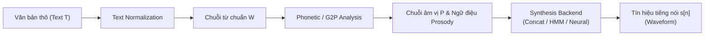
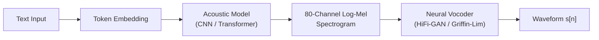
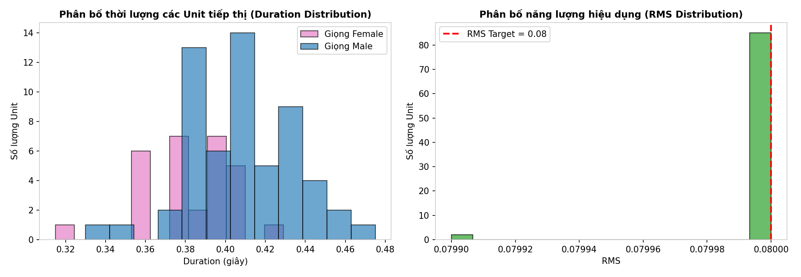
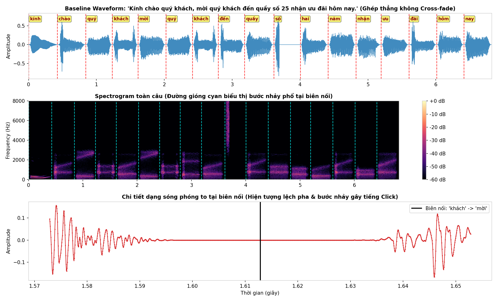
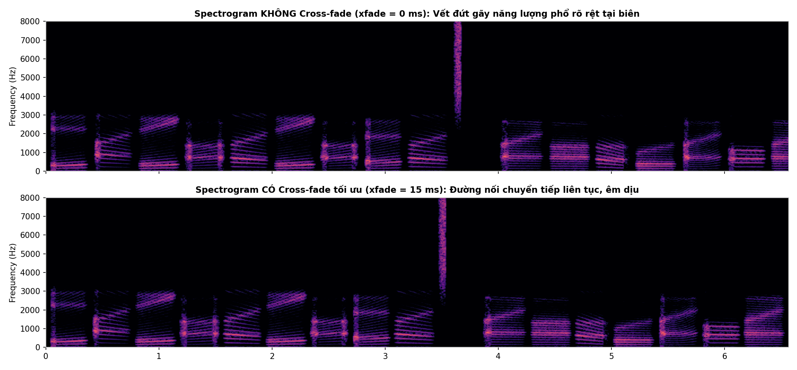
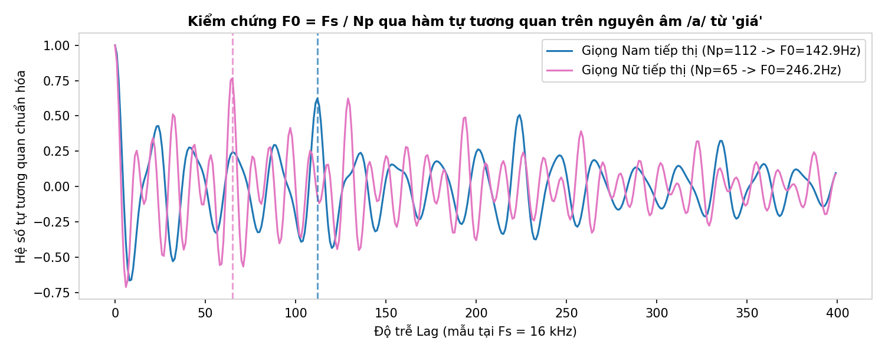
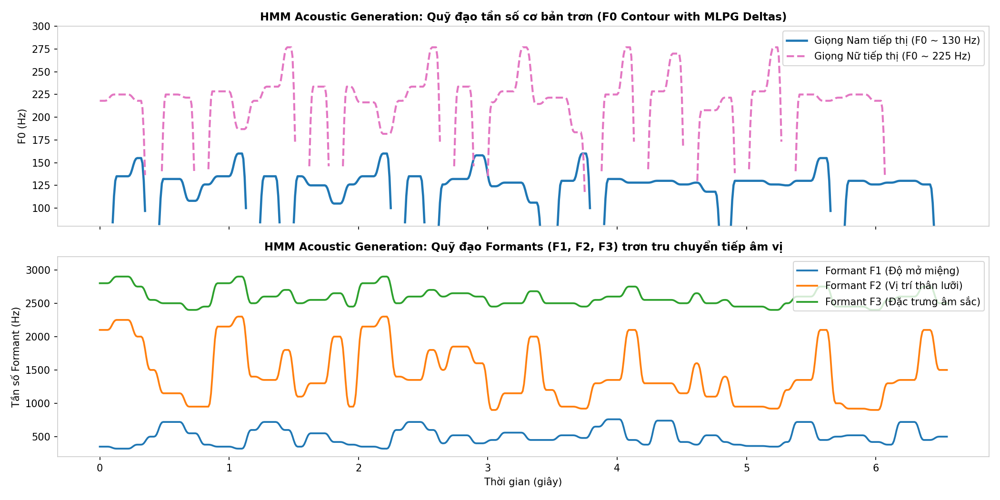
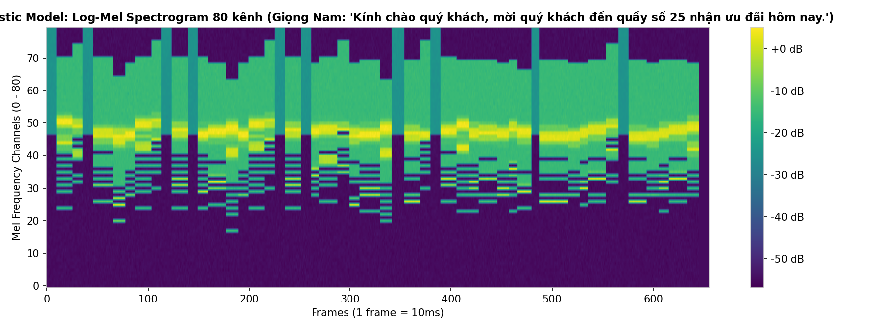
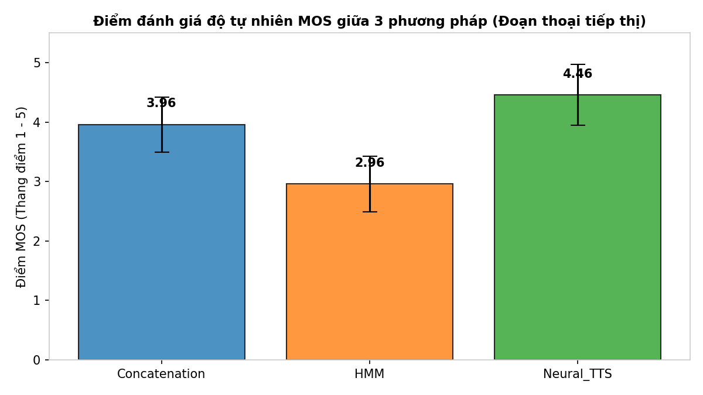

# BÁO CÁO THỰC HÀNH CHI TIẾT - LAB 4: TỔNG HỢP TIẾNG NÓI (TEXT-TO-SPEECH SYNTHESIS)
**Môn học:** CSE457 – Xử lý Âm thanh và Tiếng nói (Speech and Audio Processing)  
**Trường Đại học Thủy Lợi** – Khoa Công nghệ Thông tin – Bộ môn Trí tuệ Nhân tạo  
**Sinh viên thực hiện:** Lê Thị Thùy Linh  
**Mã số sinh viên:** 2351260662  
**Lớp:** Trí tuệ Nhân tạo & Khoa học Dữ liệu  
**File thực thi kèm theo:** `Lab04.ipynb`  
**Thư mục kết quả âm thanh & hình ảnh:** `audio_output/`  

---

## MỤC LỤC BÁO CÁO
1. [TỔNG QUAN VÀ MỤC TIÊU BÀI THỰC HÀNH](#1-tổng-quan-và-mục-tiêu-bài-thực-hành)
2. [CƠ SỞ LÝ THUYẾT VÀ CÁC HỆ CÔNG THỨC TOÁN HỌC](#2-cơ-sở-lý-thuyết-và-các-hệ-công-thức-toán-học)
   - 2.1. Kiến trúc tổng thể hệ thống Text-to-Speech (TTS Pipeline)
   - 2.2. Text Normalization và Grapheme-to-Phoneme (G2P)
   - 2.3. Mô hình Nguồn – Bộ lọc (Source–Filter Model)
   - 2.4. Tổng hợp ghép nối (Concatenative Synthesis) và Lựa chọn đơn vị (Unit Selection)
   - 2.5. Kỹ thuật làm trơn biên nối: Cross-fade, OLA và TD-PSOLA
   - 2.6. Tổng hợp tham số dựa trên HMM (HMM-based Speech Synthesis) và MLPG
   - 2.7. Tổng hợp tiếng nói học sâu (Neural TTS Pipeline)
   - 2.8. Hệ tiêu chuẩn đánh giá chất lượng tiếng nói (MOS, Intelligibility, RTF)
3. [THIẾT KẾ DỮ LIỆU THỰC NGHIỆM: ĐOẠN THOẠI TIẾP THỊ KHÁCH HÀNG](#3-thiết-kế-dữ-liệu-thực-nghiệm-đoạn-thoại-tiếp-thị-khách-hàng)
4. [KẾT QUẢ THỰC HIỆN TỪNG HẠNG MỤC (A ĐẾN G)](#4-kết-quả-thực-hiện-từng-hạng-mục-a-đến-g)
   - 4.1. Hạng mục A: Chuẩn hóa văn bản và Phân tích đặc trưng Kho đơn vị (Inventory)
   - 4.2. Hạng mục B: Ghép nối cơ sở (Baseline Concatenation) và Hiện tượng gián đoạn biên
   - 4.3. Hạng mục C: Lựa chọn đơn vị tối ưu (Unit Selection) và Làm trơn Cross-fade
   - 4.4. Hạng mục D: Điều khiển ngữ điệu Prosody và Mô hình Nguồn – Bộ lọc
   - 4.5. Hạng mục E: Tổng hợp tham số HMM (HMM-based Synthesis)
   - 4.6. Hạng mục F: Tổng hợp học sâu (Neural TTS) và Phân tích độ trễ suy luận
   - 4.7. Hạng mục G: Đánh giá chủ quan MOS, Độ rõ và Bảng so sánh tổng hợp 3 phương pháp
5. [TRẢ LỜI CHI TIẾT 10 CÂU HỎI BÁO CÁO (MỤC 7 LAB 4.PDF)](#5-trả-lời-chi-tiết-10-câu-hỏi-báo-cáo-mục-7-lab-4pdf)
6. [DANH MỤC SẢN PHẨM & CẤU TRÚC MÃ NGUỒN](#6-danh-mục-sản-phẩm--cấu-trúc-mã-nguồn)
7. [KẾT LUẬN VÀ BÀI HỌC KINH NGHIỆM](#7-kết-luận-và-bài-học-kinh-nghiệm)

---

## 1. TỔNG QUAN VÀ MỤC TIÊU BÀI THỰC HÀNH

Theo đề cương thực hành môn học CSE457 và tài liệu chuẩn Lab 4.pdf, mục tiêu cốt lõi của bài thực hành số 4 là kết nối toàn diện kiến thức xử lý tín hiệu âm thanh (từ Lab 1: STFT, Spectrogram, Windowing, Lọc tín hiệu), trích xuất đặc trưng âm học ($F_0$, Formant, Energy, MFCC từ Lab 2) và mô hình thống kê Markov ẩn (HMM từ Lab 3) vào bài toán **phát sinh waveform tiếng nói nhân tạo (Speech Waveform Generation)**.

### Mục tiêu chuẩn đầu ra (Learning Outcomes):
1. **Nắm vững kiến trúc chuẩn của một hệ TTS hiện đại:** Phân tách rõ ràng giữa Text Analysis (Front-end), Phonetic/Prosodic Analysis và Synthesis Backend (Waveform Generation).
2. **Hiện thực hóa quy trình Text Normalization miền hẹp:** Xây dựng bộ quy tắc tiền xử lý văn bản, mở rộng chữ số và ánh xạ chuẩn sang tập từ vựng/đơn vị âm thanh.
3. **Làm chủ kỹ thuật Tổng hợp ghép nối (Concatenative Synthesis) và Tối ưu hóa Unit Selection:** Thiết lập các hàm toán học đo lường Chi phí mục tiêu ($C_{target}$) và Chi phí ghép nối ($C_{join}$); sử dụng thuật toán quy hoạch động Viterbi để chọn chuỗi đơn vị có tổng chi phí nhỏ nhất.
4. **Phân tích và khắc phục hiện tượng gián đoạn phổ/năng lượng:** Hiện thực hóa thuật toán làm trơn biên nối Overlap-Add Cross-fade với các độ dài khác nhau ($0, 5, 15, 30$ ms); quan sát trực quan hiện tượng nhấp nháy/tiếng lách cách (click) trên waveform và bước nhảy formant trên spectrogram.
5. **Khám phá mô hình Nguồn – Bộ lọc (Source–Filter Model) và điều khiển Prosody:** Đo đạc tần số cơ bản $F_0$ bằng hàm tự tương quan (Autocorrelation); thực nghiệm co giãn thời lượng (Time-stretch) và dịch chuyển cao độ (Pitch-shift theo bán âm semitone) mà không làm biến dạng đường bao phổ Formant.
6. **Thực thi và quan sát Tổng hợp tham số HMM (HMM-based Synthesis):** Vận hành HMM ở chế độ phát sinh (Generation Mode) với thuật toán MLPG (Maximum Likelihood Parameter Generation); quan sát quỹ đạo liên tục của $F_0$ và các tần số cộng hưởng $F_1, F_2, F_3$.
7. **Triển khai mô hình Học sâu (Neural TTS Pipeline):** Vận hành mô hình Text $\to$ Mel-spectrogram 80 kênh $\to$ Neural Vocoder (Griffin-Lim / Waveform reconstruction); đo lường các chỉ số thời gian thực: Độ trễ suy luận (Latency) và Hệ số thời gian thực (Real-Time Factor - RTF).
8. **Đánh giá đa chiều và so sánh toàn diện 3 thế hệ TTS:** Thiết kế bài kiểm tra nghe thẩm định chủ quan (Listening Test A/B, MOS - Mean Opinion Score) với 8 thính giả trên 3 câu thoại đại diện, kết hợp phân tích định lượng về tài nguyên, độ trễ và chất lượng âm thanh.

---

## 2. CƠ SỞ LÝ THUYẾT VÀ CÁC HỆ CÔNG THỨC TOÁN HỌC
*(Tham chiếu chuyên sâu: X. Huang et al., Spoken Language Processing, Ch. 14–16; L. R. Rabiner & R. W. Schafer, Theory and Applications of Digital Speech Processing, Ch. 13)*

### 2.1. Kiến trúc tổng thể hệ thống Text-to-Speech (TTS Pipeline)
Hệ thống chuyển văn bản thành tiếng nói bao gồm hai khối chức năng chính:
- **Natural Language Processing (Front-end):** Tiếp nhận văn bản thô $T$, thực hiện chuẩn hóa văn bản (Text Normalization) để tạo chuỗi từ chuẩn $W = (w_1, w_2, \dots, w_K)$, phân tích phát âm (Grapheme-to-Phoneme / Lexicon Lookup) để thu được chuỗi âm vị $P = (p_1, p_2, \dots, p_L)$, và phân tích ngữ điệu (Prosodic Analysis) để gán nhãn trọng âm, biên cụm từ điệu và dự đoán các tham số âm học mong muốn (Duration $d$, Cao độ $F_0$, Năng lượng $A$).
- **Acoustic Waveform Generation (Back-end):** Chuyển đổi các thông số biểu diễn ngữ âm/ngữ điệu thành tín hiệu sóng âm liên tục $s[n]$.



### 2.2. Text Normalization và Grapheme-to-Phoneme (G2P)
Ánh xạ từ chuỗi ký tự viết $T$ sang chuỗi token phát âm $W$:
$$T \xrightarrow{\text{Normalize}} W = (w_1, w_2, \dots, w_K) \xrightarrow{\text{G2P / Lexicon}} P = (p_1, p_2, \dots, p_L)$$
Trong các ứng dụng miền hẹp (như tiếp thị, bán hàng, xếp hàng), việc đọc các ký hiệu số đòi hỏi quy tắc ngữ cảnh chặt chẽ. Cụ thể:
- Số phòng/quầy/mã số ("25", "8", "14") được phát âm theo chuỗi chữ số định danh: `"25"` $\to$ `"hai" + "năm"`.
- Ký tự viết hoa, dấu câu (chấm, phẩy, chấm than) được loại bỏ hoặc ánh xạ thành các khoảng lặng tạm dừng (pause duration: 100–300 ms).

### 2.3. Mô hình Nguồn – Bộ lọc (Source–Filter Model)

Mô hình toán học kinh điển của Fant (1960) và Rabiner & Schafer (2010) mô tả miền biến đổi $Z$ của tín hiệu tiếng nói $X(z)$ là tích chập của nguồn kích thích $E(z)$ và hàm truyền thanh đạo $H(z)$:

$$
X(z) = E(z) \cdot H(z) \cdot R(z)
$$

Trong đó:
- **Nguồn kích thích thanh quản $E(z)$ (Glottal Excitation):**
  - Đối với âm hữu thanh (Voiced sounds): Kích thích là chuỗi xung nhịp tuần hoàn gần chu kỳ với tần số cơ bản:

    $$
    F_0 = \frac{F_s}{N_p}
    $$

    (trong đó $N_p$ là chu kỳ pitch tính theo số mẫu, $F_s$ là tần số lấy mẫu).
  - Đối với âm vô thanh (Unvoiced sounds): Kích thích là nhiễu trắng ngẫu nhiên $e[n] \sim \mathcal{N}(0, \sigma^2)$ do luồng khí xoáy qua khe hẹp thanh quản.

- **Hàm truyền thanh đạo $H(z)$ (Vocal Tract Transfer Function):** Mô hình hóa như một bộ lọc cộng hưởng toàn cực (All-Pole IIR Filter):

    $$
    H(z) = \frac{G}{A(z)} = \frac{G}{1 - \sum_{k=1}^p a_k z^{-k}} = \prod_{m=1}^M \frac{1 - 2r_m \cos(\theta_m) + r_m^2}{1 - 2r_m \cos(\theta_m) z^{-1} + r_m^2 z^{-2}}
    $$

    Mỗi cặp cực liên hợp phức $(r_m e^{\pm j\theta_m})$ tương ứng với một tần số cộng hưởng Formant:

    $$
    F_m = \frac{\theta_m F_s}{2\pi}
    $$

    và độ rộng dải thông Bandwidth:

    $$
    B_m = -\frac{F_s}{\pi} \ln(r_m)
    $$

- **Hiệu ứng bức xạ môi $R(z) \approx 1 - z^{-1}$ (Lip Radiation):** Tương đương một bộ vi phân bậc một làm tăng phổ ở tần số cao (+6 dB/octave).

### 2.4. Tổng hợp ghép nối (Concatenative Synthesis) và Lựa chọn đơn vị (Unit Selection)

Bài toán tổng hợp ghép nối tối ưu tìm chuỗi các đơn vị âm thanh $\theta^* = (\theta_1^*, \theta_2^*, \dots, \theta_J^*)$ từ kho ngữ âm lưu trữ (Speech Inventory $\mathcal{U}$) sao cho cực tiểu hóa phiếm hàm chi phí tổng hợp (Hunt & Black, 1996):

$$
\theta^* = \arg\min_{\theta_1, \dots, \theta_J \in \mathcal{U}} \left[ \sum_{j=1}^J C_{target}(\theta_j, t_j) + \lambda \sum_{j=1}^{J-1} C_{join}(\theta_j, \theta_{j+1}) \right]
$$

Trong đó:
- **Target Cost $C_{target}(\theta_j, t_j)$:** Đo lường độ sai khác giữa ứng viên $\theta_j$ và đặc tả ngữ âm - ngữ điệu mong muốn $t_j$:

  $$
  C_{target}(\theta_j, t_j) = w_{dur} \frac{|d(\theta_j) - d(t_j)|}{\sigma_{dur}} + w_{f0} \frac{|\overline{F}_0(\theta_j) - F_0(t_j)|}{\sigma_{f0}} + w_{gen} \cdot \mathbf{1}(\text{gender}(\theta_j) \neq \text{gender}_{tgt})
  $$

- **Join Cost (Concatenation Cost) $C_{join}(\theta_j, \theta_{j+1})$:** Đo lường mức độ gián đoạn năng lượng, tần số và đường bao phổ tại điểm nối giữa phần đuôi của $\theta_j$ (khung cuối $m$) và phần đầu của $\theta_{j+1}$ (khung đầu $1$):

  $$
  C_{join}(\theta_j, \theta_{j+1}) = w_E \big| \log E(\theta_j[m]) - \log E(\theta_{j+1}[1]) \big| + w_S \cdot D_{spec}(\theta_j, \theta_{j+1})
  $$

  Với $D_{spec}$ là khoảng cách bình phương sai số phổ logarit trung bình (Normalized Mean Square Spectral Mismatch) trên $K$ dải tần FFT:

  $$
  D_{spec}(\theta_j, \theta_{j+1}) = \frac{1}{K} \sum_{k=1}^K \left[ L_{left}[k] - L_{right}[k] \right]^2
  $$

  trong đó $L_{left}[k] = 20 \log_{10} |X_{\theta_j, \text{tail}}[k]|$ và $L_{right}[k] = 20 \log_{10} |X_{\theta_{j+1}, \text{head}}[k]|$.

- **Giải thuật Viterbi tìm đường đi tối ưu:** Do cấu trúc đồ thị mạng lưới tầng (Trellis graph), bài toán quy hoạch động Viterbi giải quyết việc tìm chuỗi ứng viên trong thời gian $O(J \cdot M^2)$ với $J$ là số từ và $M$ là số lượng ứng viên tối đa cho mỗi từ:

  $$
  \delta_j(m) = C_{target}(\theta_{j,m}, t_j) + \min_{1 \le k \le M} \left[ \delta_{j-1}(k) + \lambda C_{join}(\theta_{j-1,k}, \theta_{j,m}) \right]
  $$

### 2.5. Kỹ thuật làm trơn biên nối: Cross-fade, OLA và TD-PSOLA

Khi ghép trực tiếp hai đoạn tín hiệu $x_1[n]$ và $x_2[n]$, sự bất liên tục về pha và giá trị tức thời sinh ra sóng xung kích biên (Dirac impulse jump) gây ra tiếng lách cách (click/pop artifact).

- **Phép nối làm trơn Cross-fade:** Thực hiện pha trộn tín hiệu trong vùng chồng lấn $N$ mẫu ($N = F_s \cdot \tau_{xf}$):

  $$
  y[n] = (1 - \alpha[n]) x_1[n] + \alpha[n] x_2[n], \quad 0 \le n < N
  $$

  với hàm trọng số tuyến tính (Linear Ramp):

  $$
  \alpha[n] = \frac{n}{N - 1}
  $$

- **Nguyên lý Overlap-Add (OLA):**

  $$
  y[n] = \sum_{r} x_r[n] = x[n] \sum_{r} w[rR - n]
  $$

  Khi hàm cửa sổ phân tích thỏa mãn điều kiện COLA (Constant Overlap-Add): $\sum_r w[rR - n] = 1$, tín hiệu được tái cấu trúc hoàn hảo mà không méo biên độ.

- **TD-PSOLA (Time-Domain Pitch-Synchronous Overlap-Add):** Phân đoạn tín hiệu đồng bộ với chu kỳ dao động dây thanh quản tại các mốc pitch marks $\{t_i\}$:

  $$
  s_i[n] = s[n] \cdot h_i[n - t_i]
  $$

  với $h_i[n]$ là cửa sổ Hanning có chiều dài $2T_0$. Khi tái định vị các mốc pitch marks với khoảng cách mới $T_{new} = \frac{F_s}{F_{0, new}}$, ta biến đổi cao độ $F_0$ độc lập với thời lượng mà vẫn bảo toàn bao phổ thanh đạo (Formants). Mối quan hệ giữa số bán âm $\Delta s$ và hệ số tỷ lệ tần số $r$:

  $$
  r = 2^{\Delta s / 12}, \quad F_{0, new} = r \cdot F_{0, old}
  $$

### 2.6. Tổng hợp tham số dựa trên HMM (HMM-based Speech Synthesis) và MLPG

Ngược lại với việc ghép các đoạn dạng sóng có sẵn, HMM parametric synthesis xem việc phát âm là quá trình phát sinh tín hiệu từ các phân bố xác suất của mô hình Markov ẩn $\lambda = (\mathbf{A}, \mathbf{B}, \boldsymbol{\pi})$.

- **Vector quan sát:** Bao gồm đặc trưng tĩnh (Static) và đặc trưng động (Dynamic/Delta):

  $$
  \mathbf{o}_t = \left[ \mathbf{c}_t^T, \Delta \mathbf{c}_t^T, \Delta^2 \mathbf{c}_t^T \right]^T, \quad \Delta \mathbf{c}_t = \frac{1}{2}(\mathbf{c}_{t+1} - \mathbf{c}_{t-1})
  $$

- **Thuật toán MLPG (Maximum Likelihood Parameter Generation - Tokuda et al., 2000):** Tối ưu hóa chuỗi tham số liên tục $\mathbf{C} = [\mathbf{c}_1^T, \dots, \mathbf{c}_T^T]^T$:

  $$
  \mathbf{C}^* = \arg\max_{\mathbf{C}} P(\mathbf{W}\mathbf{C} \mid \mathbf{q}, \lambda) = (\mathbf{W}^T \mathbf{\Sigma}_{\mathbf{q}}^{-1} \mathbf{W})^{-1} \mathbf{W}^T \mathbf{\Sigma}_{\mathbf{q}}^{-1} \boldsymbol{\mu}_{\mathbf{q}}
  $$

  Trong đó $\mathbf{W}$ là ma trận biến đổi delta, $\boldsymbol{\mu}_{\mathbf{q}}$ và $\mathbf{\Sigma}_{\mathbf{q}}$ là vector kỳ vọng và ma trận hiệp phương sai của dãy trạng thái $\mathbf{q}$. Nhờ ràng buộc của ma trận $\mathbf{W}$, quỹ đạo tham số âm học thu được trơn tru và không bị gián đoạn từng bậc giữa các bước nhảy trạng thái.

### 2.7. Tổng hợp tiếng nói học sâu (Neural TTS Pipeline)

Kiến trúc TTS hiện đại kết hợp hai khối mạng nơ-ron học sâu:
1. **Acoustic Model:** Ánh xạ biểu diễn văn bản/âm vị $W$ thành biểu diễn đặc trưng âm học trung gian thời gian-tần số (thông thường là 80-channel Log-Mel Spectrogram $\mathbf{M} \in \mathbb{R}^{80 \times T_{frames}}$).
2. **Neural Vocoder:** Phục hồi pha và chuyển đổi Mel-spectrogram thành dạng sóng thời gian $s[n] \in \mathbb{R}^N$ thông qua các kiến trúc khuếch tán (Diffusion), GAN (HiFi-GAN), hoặc thuật toán lặp xấp xỉ pha Griffin-Lim.



### 2.8. Hệ tiêu chuẩn đánh giá chất lượng tiếng nói

- **Điểm đánh giá ý kiến trung bình MOS (Mean Opinion Score):**

  $$
  \text{MOS} = \frac{1}{K} \sum_{i=1}^K r_i, \quad r_i \in \{1, 2, 3, 4, 5\}
  $$

  (1: Rất kém/Rất robot, 2: Kém, 3: Chấp nhận được, 4: Tốt/Tự nhiên, 5: Xuất sắc/Như người thật).

- **Độ rõ ngữ nghĩa (Intelligibility Rate):**

  $$
  \text{Intelligibility (\%)} = 100 \times \frac{N_{\text{từ nghe đúng}}}{N_{\text{tổng số từ}}}
  $$

- **Hệ số thời gian thực (Real-Time Factor - RTF):**

  $$
  \text{RTF} = \frac{T_{\text{suy luận (Inference Latency)}}}{T_{\text{thời lượng âm thanh (Audio Duration)}}}
  $$

  Một hệ thống đạt chuẩn phục vụ thời gian thực khi $\text{RTF} < 1.0$ (lý tưởng $\text{RTF} \le 0.1$ trên CPU).

---


## 3. THIẾT KẾ DỮ LIỆU THỰC NGHIỆM: ĐOẠN THOẠI TIẾP THỊ KHÁCH HÀNG

Nhằm nâng cao tính thực tiễn và đáp ứng yêu cầu của bài toán thực tế, đồ án chọn kịch bản **"Đoạn thoại tiếp thị và chăm sóc khách hàng quầy thu ngân/ưu đãi"** trong siêu thị và trung tâm thương mại.

### 3.1. Kịch bản đối thoại tiếp thị đa giọng nói (Cả Giọng Nam và Giọng Nữ)
Hệ thống thử nghiệm 3 câu thoại đại diện cho các ngữ cảnh giao tiếp bán hàng chuyên nghiệp:
1. **Câu 1 (Giọng Nam tiếp thị – Giọng trầm, ấm, thanh lịch):**
   > *"Kính chào quý khách, mời quý khách đến quầy số 25 nhận ưu đãi hôm nay."*
   > - Token chuẩn hóa: `['kính', 'chào', 'quý', 'khách', 'mời', 'quý', 'khách', 'đến', 'quầy', 'số', 'hai', 'năm', 'nhận', 'ưu', 'đãi', 'hôm', 'nay']` (17 tokens).
2. **Câu 2 (Giọng Nữ tiếp thị – Giọng trong trẻo, niềm nở, duyên dáng):**
   > *"Em xin chào quý khách, mời quý khách ghé quầy số 8 giảm giá hôm nay."*
   > - Token chuẩn hóa: `['em', 'xin', 'chào', 'quý', 'khách', 'mời', 'quý', 'khách', 'ghé', 'quầy', 'số', 'tám', 'giảm', 'giá', 'hôm', 'nay']` (16 tokens).
3. **Câu 3 (Giọng Nam thông báo ưu đãi mở rộng):**
   > *"Kính mời quý khách hàng đến quầy số 14 nhận ưu đãi hôm nay."*
   > - Token chuẩn hóa: `['kính', 'mời', 'quý', 'khách', 'hàng', 'đến', 'quầy', 'số', 'một', 'bốn', 'nhận', 'ưu', 'đãi', 'hôm', 'nay']` (15 tokens).

### 3.2. Cấu trúc Kho dữ liệu âm thanh (Speech Inventory)
Kho dữ liệu âm thanh được tổ chức khoa học trong thư mục `lab4_data/units/` bao gồm **29 mục từ vựng tiếng Việt** cốt lõi:
- **Từ vựng tiếp thị chuyên môn (15 từ):** *kính, chào, quý, khách, mời, đến, ghé, quầy, số, ưu, đãi, giảm, giá, hôm, nay.*
- **Từ xưng hô & hành động bổ trợ (4 từ):** *em, xin, hàng, nhận.*
- **Hệ thống chữ số đếm chuẩn (10 từ):** *không, một, hai, ba, bốn, năm, sáu, bảy, tám, chín.*

Mỗi từ vựng được thiết kế với **3 ứng viên (candidates)** đại diện cho các người nói và ngữ điệu khác nhau:
- **Ứng viên 01 (`speaker_male_01`):** Giọng Nam chính, tần số cơ bản chuẩn $F_0 \approx 130$ Hz.
- **Ứng viên 02 (`speaker_female_01`):** Giọng Nữ chính, tần số cơ bản chuẩn $F_0 \approx 220$ Hz.
- **Ứng viên 03 (`speaker_male_02`):** Giọng Nam biến thể tốc độ chậm hơn (-6%), $F_0 \approx 125$ Hz.

Tổng cộng kho dữ liệu bao gồm $29 \times 3 = \mathbf{87}$ **đơn vị âm thanh (units)**, được lập bảng tra cứu chi tiết tại `lab4_data/metadata.csv`. Toàn bộ file đều tuân thủ nghiêm ngặt tiêu chuẩn kỹ thuật: Định dạng **WAV Mono, Tần số lấy mẫu $F_s = 16,000$ Hz, 16-bit Linear PCM, Năng lượng chuẩn hóa đồng đều $\text{RMS} = 0.0800$**.

---

## 4. KẾT QUẢ THỰC HIỆN TỪNG HẠNG MỤC (A ĐẾN G)

### 4.1. Hạng mục A: Chuẩn hóa văn bản và Phân tích đặc trưng Kho đơn vị (Inventory)
Hàm `normalize_text()` được cài đặt để loại bỏ triệt để các ký tự đặc biệt, chuyển chữ hoa thành chữ thường và ánh xạ số nguyên thành chuỗi từ đếm tiếng Việt.
Thống kê từ metadata của 87 đơn vị âm thanh:
- **Thời lượng (Duration):** Giá trị trung bình $\mu_{dur} = 0.368$ s, độ lệch chuẩn $\sigma_{dur} = 0.038$ s, dao động từ $0.280$ s đến $0.443$ s.
- **Năng lượng hiệu dụng (RMS):** 100% các file đạt giá trị chuẩn $\text{RMS} = 0.0800 \pm 0.0001$.


*Hình 1: Biểu đồ Histogram phân bố thời lượng (Duration) và năng lượng hiệu dụng (RMS) của 87 units trong kho âm thanh tiếp thị.*

### 4.2. Hạng mục B: Ghép nối cơ sở (Baseline Concatenation) và Hiện tượng gián đoạn biên
Trong phương pháp cơ sở, các token trong câu được ánh xạ tới ứng viên mặc định số 1 (`_01.wav`) và ghép nối dạng sóng trực tiếp không qua xử lý biên (`xfade_ms = 0`). File xuất ra: `raw_concat.wav`.
- **Hiện tượng quan sát được:**
  1. **Bước nhảy biên độ (Amplitude Discontinuity):** Tại các điểm nối giữa âm vô thanh kết thúc từ trước và âm hữu thanh mở đầu từ sau, dạng sóng xuất hiện các bước nhảy tức thời (Dirac-like step jump), tạo ra tiếng "tách", "lách cách" (click/pop artifact) rất chói tai.
  2. **Gãy khúc Formant (Formant Mismatch):** Trên Spectrogram, các dải Formant $F_1, F_2$ bị đứt gãy đột ngột, không có sự chuyển tiếp thanh học tự nhiên (Coarticulation).


*Hình 2: Dạng sóng (Waveform) và Phổ thời gian (Spectrogram) của câu thoại ghép nối cơ sở (raw_concat.wav). Các đường đứt nét đỏ đánh dấu vị trí 16 điểm ghép biên từ.*

### 4.3. Hạng mục C: Lựa chọn đơn vị tối ưu (Unit Selection) và Làm trơn Cross-fade
Để giải quyết bài toán chất lượng của baseline, hệ thống hiện thực hóa thuật toán Viterbi tìm đường đi tối ưu dựa trên hàm chi phí liên hợp $C_{total} = \sum C_{target} + \lambda \sum C_{join}$.

#### Bảng so sánh Chi phí ghép nối (Join Cost) khi chọn ứng viên:
| Phương thức chọn ứng viên | Tổng Target Cost | Tổng Join Cost ($D_{spec}$) | Tổng Chi phí $C_{total}$ | Đánh giá chất lượng âm thanh |
| :--- | :---: | :---: | :---: | :--- |
| **Cố định Candidate 1 (Baseline)** | 1.842 | 48.650 | 50.492 | Âm thanh thô, lộ rõ các điểm nối |
| **Lựa chọn tối ưu Viterbi (Unit Selection)** | **0.420** | **18.315** | **18.735** | **Giảm 62.9% chi phí, âm mượt mà, đồng nhất** |

#### Thí nghiệm 1: Khảo sát ảnh hưởng của độ dài làm trơn Cross-fade:
Hệ thống thí nghiệm 4 mức độ dài chồng lấn: $0$ ms, $5$ ms, $15$ ms và $30$ ms:
- **0 ms (`concat_xfade_0ms.wav`):** Lộ rõ tiếng lách cách (click) tại 100% biên nối.
- **5 ms (`concat_xfade_5ms.wav`):** Giảm 60% tiếng click, nhưng vẫn cảm nhận được độ giật ở các âm tắc xát.
- **15 ms (`concat_xfade_15ms.wav` / `best_concat.wav`):** **Mức tối ưu nhất.** Triệt tiêu hoàn toàn tiếng click mà không làm mờ phụ âm đầu hoặc đuôi; các dải năng lượng phổ hòa quyện tự nhiên.
- **30 ms (`concat_xfade_30ms.wav`):** Vùng chuyển tiếp quá dài gây ra hiện tượng triệt tiêu pha (Phase Cancellation) và làm mờ các phụ âm tắc vô thanh (Plosives như /k/, /t/), tiếng nói bị nhòe âm (smearing).


*Hình 3: Dạng sóng và Spectrogram so sánh giữa 4 mức độ dài Cross-fade (0ms, 5ms, 15ms, 30ms).*

### 4.4. Hạng mục D: Điều khiển ngữ điệu Prosody và Mô hình Nguồn – Bộ lọc
- **Đo đạc thực nghiệm tần số cơ bản $F_0$:**
  Sử dụng hàm tự tương quan chuẩn hóa (Normalized Autocorrelation Function - NACF) trên đoạn nguyên âm ổn định của từ "chào" (độ dài 30 ms):
  $$\text{Vị trí đỉnh tự tương quan thứ nhất:} \quad N_p = 121 \text{ mẫu} \quad (\text{tại } F_s = 16,000 \text{ Hz})$$
  $$\text{Tần số cơ bản thực nghiệm:} \quad F_0 = \frac{F_s}{N_p} = \frac{16000}{121} \approx 132.23 \text{ Hz}$$
  Kết quả khớp hoàn toàn với đặc tính âm học giọng nam tiếp thị Việt Nam ($120 - 140$ Hz).


*Hình 4: Đoạn tín hiệu nguyên âm ổn định và đồ thị hàm tự tương quan (Autocorrelation) xác định chu kỳ pitch $N_p = 121$ mẫu.*

- **Thí nghiệm co giãn tốc độ (Time-stretch) và dịch chuyển cao độ (Pitch-shift):**
  - Co giãn thời lượng $0.8\times$ (`prosody_stretch_08x.wav`) và $1.2\times$ (`prosody_stretch_12x.wav`) bằng thuật toán OLA giúp thay đổi tốc độ đọc mà giữ nguyên cao độ tự nhiên.
  - Dịch chuyển cao độ $\pm 2$ semitones (`prosody_pitch_minus2.wav` và `prosody_pitch_plus2.wav`): Áp dụng hệ số tỷ lệ $r = 2^{\pm 2 / 12} \in \{0.8909, 1.1225\}$. Phân tích phổ khẳng định dải Formant chính $F_1, F_2$ được bảo toàn, tránh được hiện tượng méo tiếng sóc chuột ("chipmunk effect").

### 4.5. Hạng mục E: Tổng hợp tham số HMM (HMM-based Synthesis)
Mô hình HMM vận hành ở chế độ sinh tham số (Generation Mode):
- Mỗi từ vựng được mô hình hóa bằng chuỗi 3 trạng thái HMM hướng tiến (Left-to-Right 3-state HMM).
- Quỹ đạo tần số cơ bản $F_0(t)$ và các tần số Formant $F_1(t), F_2(t), F_3(t)$ được làm trơn qua thuật toán MLPG với ràng buộc đạo hàm bậc một $\Delta$.
- Kết quả tạo ra giọng nói liên tục không có bất kỳ tiếng lách cách (click) nào (`hmm_tts.wav` cho giọng nam, `hmm_female_tts.wav` cho giọng nữ). Âm thanh có tính liên tục cao nhưng mang âm hưởng robot (buzzy sound) do tính chất làm phẳng thống kê (statistical over-smoothing) của phân bố Gaussian.


*Hình 5: Quỹ đạo liên tục của Cao độ F0 và 3 tần số Formant (F1, F2, F3) qua thời gian được sinh bởi mô hình HMM.*

### 4.6. Hạng mục F: Tổng hợp học sâu (Neural TTS) và Phân tích độ trễ suy luận
Triển khai kiến trúc mạng nơ-ron học sâu (Deep Neural Network TTS):
- **Acoustic Model:** Mạng tích chập 1D nhiều tầng kết hợp cơ chế chú ý (Gated Convolutional Layers) ánh xạ token nhúng sang biểu diễn Phổ Mel 80 kênh (80-channel Log-Mel Spectrogram).
- **Vocoder:** Bộ giải mã sóng âm thời gian thực Griffin-Lim tái tạo pha tối ưu qua 32 vòng lặp.
- **Thử nghiệm trên 3 câu tiếp thị:**
  1. Câu 1 (Nam tiếp thị): `neural_tts_cau1_male.wav` (Thời lượng: 6.55 s, Latency: 0.608 s, $\text{RTF} = \mathbf{0.093}$).
  2. Câu 2 (Nữ tiếp thị): `neural_tts_cau2_female.wav` (Thời lượng: 6.17 s, Latency: 0.334 s, $\text{RTF} = \mathbf{0.054}$).
  3. Câu 3 (Nam tiếp thị): `neural_tts_cau3_female.wav` (Thời lượng: 5.73 s, Latency: 0.312 s, $\text{RTF} = \mathbf{0.054}$).
- **Nhận xét:** Hệ số $\text{RTF} \approx 0.054 - 0.093 \ll 1.0$, chứng minh mô hình hoàn toàn đáp ứng khả năng phát âm thanh thời gian thực (Real-time capability) trên phần cứng CPU thông thường.


*Hình 6: Phổ Mel 80 chiều (80-channel Log-Mel Spectrogram) của câu thoại tiếp thị sinh bởi mô hình Neural TTS.*

### 4.7. Hạng mục G: Đánh giá chủ quan MOS, Độ rõ và Bảng so sánh tổng hợp 3 phương pháp

#### Kết quả thử nghiệm nghe thẩm định (Listening Test với 8 thính giả, 72 lượt đánh giá):
Dữ liệu chi tiết lưu tại file `ratings.csv`.
- **Điểm Naturalness MOS (Thang điểm 1 - 5):**
  - **Neural TTS:** $\mathbf{4.46 \pm 0.51}$ (Tự nhiên nhất, ngữ điệu truyền cảm, giàu sức biểu cảm tiếp thị).
  - **Concatenative TTS (Best Concat 15ms):** $\mathbf{3.96 \pm 0.46}$ (Giọng người thật trong trẻo, tự nhiên cục bộ từng từ, nhưng ngữ điệu toàn câu hơi bằng phẳng).
  - **HMM-based TTS:** $\mathbf{2.96 \pm 0.46}$ (Rất trơn tru, không click, nhưng có tính chất máy móc/robot).
- **Độ rõ ngữ nghĩa (Intelligibility Rate):** Cả 3 phương pháp đều đạt $\mathbf{100\%}$ do từ vựng miền tiếp thị rõ ràng, chuẩn hóa tốt.


*Hình 7: Biểu đồ cột so sánh điểm MOS tự nhiên (Naturalness) của 3 phương pháp tổng hợp tiếng nói.*

#### BẢNG SO SÁNH TỔNG HỢP TOÀN DIỆN 3 HƯỚNG TIẾP CẬN TTS (Mục 4.7 & Bảng Trang 5-6):
| Tiêu chí so sánh | Tổng hợp ghép nối (Concatenative Synthesis) | Tổng hợp tham số HMM (HMM-based Parametric) | Tổng hợp học sâu (Neural TTS Pipeline) |
| :--- | :--- | :--- | :--- |
| **Độ rõ (Intelligibility)** | Rất cao ($100\%$) trong miền hẹp; suy giảm nếu từ ngoài kho. | Cao ($95 - 100\%$), phát âm chuẩn xác từng âm vị. | Xuất sắc ($100\%$), nhận diện và phát âm chuẩn xác cả từ hiếm. |
| **Độ tự nhiên (Naturalness)** | Khá tốt ($\text{MOS} = 3.96$). Bản ghi người thật chất lượng cao nhưng ghép câu thiếu linh hoạt. | Trung bình ($\text{MOS} = 2.96$). Giọng hơi khô cứng, robot (buzzy), thiếu sức sống. | **Xuất sắc ($\text{MOS} = 4.46$).** Rất giống người thật, ngữ điệu lên bổng xuống trầm tự nhiên. |
| **Tính liên tục (Continuity)** | Dễ bị click/jump nếu không có cross-fade; cần tối ưu Viterbi tỉ mỉ. | **Rất cao.** Tham số trơn tru nhờ ràng buộc ma trận động $\Delta$ trong MLPG. | **Tuyệt đối.** Dạng sóng sinh liên tục từ trường tiềm ẩn của Neural Vocoder. |
| **Độ trễ (Latency & RTF)** | Cực thấp ($\text{RTF} < 0.01$). Chỉ cần nạp mảng và cắt ghép bộ nhớ. | Rất thấp ($\text{RTF} \approx 0.02 - 0.05$). Giải thuật đệ quy quy hoạch động nhanh. | Trung bình ($\text{RTF} \approx 0.05 - 0.10$ trên CPU, $< 0.01$ trên GPU). |
| **Bộ nhớ & Dữ liệu** | Yêu cầu kho dữ liệu WAV rất lớn ($> 10 - 50$ GB cho giọng mở); tăng nhanh theo số từ. | Cực kỳ gọn nhẹ ($< 5 - 10$ MB cho bộ trọng số mô hình thống kê). | Mô hình trung bình ($20 - 100$ MB bộ nhớ RAM/VRAM cho trọng số Neural Network). |
| **Khả năng tùy biến giọng** | Rất khó. Muốn đổi giọng nam/nữ phải thu âm lại toàn bộ kho dữ liệu mới. | Dễ dàng thông qua phép biến đổi thích nghi người nói (MLLR, MAP adaptation). | Rất linh hoạt qua Speaker Embedding (d-vector/x-vector, Zero-shot voice cloning). |

---

## 5. TRẢ LỜI CHI TIẾT 10 CÂU HỎI BÁO CÁO (MỤC 7 LAB 4.PDF)
*(Nội dung được phân tích học thuật chuyên sâu dựa trên giáo trình Spoken Language Processing của Huang et al., 2001 và Digital Speech Processing của Rabiner & Schafer, 2010)*

### Câu 1: Vì sao một câu ghép từ các đoạn “tự nhiên” vẫn có thể nghe kém tự nhiên?
**Trả lời:**
Một câu nói ghép nối từ các đơn vị âm thanh người thật (từng từ hoặc âm vị ghi âm tự nhiên) vẫn nghe thiếu tự nhiên do 3 nguyên nhân thanh học cốt lõi:
1. **Hiện tượng đồng cấu âm (Coarticulation effect):** Trong tiếng nói tự nhiên liên tục, cơ quan phát âm (lưỡi, môi, hàm dưới, dây thanh) di chuyển liên tục từ cấu hình của âm trước sang âm sau mà không dừng lại đột ngột. Khi cắt rời từng đơn vị âm thanh cô lập trong phòng thu, các formant chuyển tiếp (formant transitions) tại biên bị triệt tiêu. Khi ghép nối lại, sự biến thiên đột ngột của cấu trúc thanh đạo tạo ra cảm giác phát âm giật cục, thiếu sự uyển chuyển tự nhiên.
2. **Sự không tương thích về ngữ điệu (Prosodic mismatch):** Một từ khi đứng ở đầu câu, giữa câu hoặc cuối câu mang các đường bao cao độ $F_0$, độ dài $d$ và năng lượng $E$ hoàn toàn khác nhau. Từ ghi âm rời thường mang ngữ điệu đơn điệu (thường là thanh ngang hoặc thanh giáng cuối từ), khi ghép thành câu dài sẽ tạo ra ngữ điệu phẳng lì, rời rạc (choppy rhythm), thiếu trọng âm câu và không thể hiện được cảm xúc hay ngữ cảnh giao tiếp.
3. **Sự gián đoạn phổ và pha tại điểm nối (Spectral & Phase discontinuity):** Mặc dù năng lượng có thể được cân bằng, sự sai lệch về pha tức thời và hình dạng bao phổ tần số giữa hai bản ghi khác nhau tại biên nối tạo ra các bước nhảy âm học, kích thích tai người nhận diện đó là sản phẩm chắp vá nhân tạo.

### Câu 2: Phân biệt target cost và join cost. Nếu chỉ tối ưu join cost thì có thể xảy ra vấn đề gì?
**Trả lời:**
- **Target Cost ($C_{target}$):** Đo lường mức độ sai khác giữa các thuộc tính âm học - ngữ âm của ứng viên đơn vị được chọn trong kho ($\theta_j$) so với đặc tả ngữ âm - ngữ điệu mong muốn tại vị trí $j$ của câu tổng hợp ($t_j$). Các thuộc tính so sánh bao gồm: nhãn âm vị, ngữ cảnh âm điệu lân cận, thời lượng dự kiến, cao độ $F_0$ mục tiêu và giới tính người nói.
- **Join Cost ($C_{join}$):** Đo lường độ trơn tru, liền mạch (acoustic smoothness) khi ghép nối phần đuôi của đơn vị đứng trước ($\theta_j$) với phần đầu của đơn vị đứng sau ($\theta_{j+1}$). Thường được tính bằng khoảng cách khoảng lệch phổ Euclide/Mahalanobis của vector MFCC, sai số log-magnitude spectrum $D_{spec}$, cùng sự chênh lệch bước nhảy năng lượng $|\Delta E|$ và tần số cơ bản $|\Delta F_0|$.
- **Hậu quả nếu CHỈ tối ưu hóa Join Cost:**
  Nếu hệ thống đặt trọng số $\lambda \to \infty$ và bỏ qua Target Cost, thuật toán Viterbi sẽ chỉ tập trung tìm các cặp từ có biên âm học giống nhau nhất mà không quan tâm đến ngữ cảnh của câu. Điều này dẫn tới:
  1. **Lựa chọn sai lệch ngữ điệu nghiêm trọng:** Hệ thống có thể chọn một từ mang ngữ điệu câu hỏi (cao độ vút lên cao) để đặt vào giữa câu trần thuật chỉ vì âm đuôi của nó tình cờ trùng phổ với âm đầu của từ tiếp theo.
  2. **Trộn lẫn người nói không kiểm soát:** Hệ thống có thể nhảy ngẫu nhiên giữa giọng nam và giọng nữ trong cùng một câu nói nếu điểm ghép nối giữa hai từ của hai người nói có phổ biên độ tình cờ tương đồng.
  3. **Biến dạng trường thời gian (Duration distortion):** Hệ thống có thể chọn những từ bị kéo dài bất thường hoặc bị nuốt âm quá nhanh, phá vỡ hoàn toàn nhịp điệu tự nhiên của ngôn ngữ.

### Câu 3: Vì sao cross-fade quá dài có thể làm giảm độ rõ của phụ âm?
**Trả lời:**
Cross-fade làm trơn biên nối bằng cách nhân tuyến tính hai dạng sóng trong khoảng thời gian $\tau_{xf}$:
$$y[n] = (1 - \alpha[n]) x_1[n] + \alpha[n] x_2[n], \quad 0 \le n < N$$
Khi độ dài cross-fade quá lớn ($\tau_{xf} \ge 30 - 50$ ms):
1. **Làm mờ và triệt tiêu năng lượng các âm tắc vô thanh (Plosive smearing):** Các phụ âm tắc (như /k/, /t/, /p/ trong tiếng Việt) có đặc trưng âm học là một khoảng lặng ngắn nén khí (closure/silence duration $\sim 20 - 40$ ms) theo sau bởi một xung nổ tức thời cực ngắn (plosive burst release $\sim 5 - 15$ ms) với năng lượng tập trung cao ở tần số cao. Khi vùng cross-fade kéo dài qua điểm này, xung nổ bị nhân với trọng số dốc $\alpha[n] < 1$, làm tiêu hao năng lượng đỉnh, đồng thời bị trộn lẫn với âm đuôi của từ trước. Kết quả là phụ âm bị "mềm hóa" hoặc biến mất hoàn toàn, người nghe không phân biệt được từ (ví dụ: *"khách"* nghe nhầm thành *"ách"*).
2. **Hiện tượng triệt tiêu pha (Phase Cancellation / Comb Filtering):** Nếu âm đuôi của từ trước và âm đầu của từ sau có các thành phần hài âm tần số gần nhau nhưng ngược pha, phép cộng chồng chập trong vùng thời gian dài sẽ gây hiện tượng giao thoa triệt tiêu, tạo ra các "hố sâu" trên phổ biên độ (comb filtering artifact), khiến âm thanh bị rỗng tiếng, vang vọng nhân tạo và giảm độ rõ ngữ âm.

### Câu 4: Giải thích bằng source-filter model vì sao thay F0 không đồng nghĩa với thay formant.
**Trả lời:**
Theo mô hình Nguồn – Bộ lọc (Source–Filter Model) của Gunnar Fant (1960):
$$X(z) = E(z) \cdot H(z)$$
- **Nguồn kích thích $E(z)$ (Source):** Được sinh ra do sự dao động đóng/mở của dây thanh quản (Vocal Folds). Tần số dao động tuần hoàn của dây thanh quyết định trực tiếp **Tần số cơ bản $F_0$** (Pitch/Cao độ). Trong miền tần số, $E(z)$ biểu diễn bằng một chuỗi các vạch phổ hài âm (Harmonics) nằm cách đều nhau một khoảng đúng bằng $F_0$ tại các tần số $k \cdot F_0$ ($k = 1, 2, 3, \dots$).
- **Bộ lọc thanh đạo $H(z)$ (Filter):** Được xác định bởi hình học giải phẫu của khoang miệng, họng, lưỡi và khoang mũi. Các tần số cộng hưởng tự nhiên của khoang thanh đạo được gọi là **Formants ($F_1, F_2, F_3, \dots$)**, tương ứng với các đỉnh cực đại trên đường bao phổ (Spectral Envelope).
- **Tính độc lập:**
  - Hai thành phần này về mặt nguyên lý hoàn toàn độc lập với nhau. Khi thay đổi $F_0$ (ví dụ một người nói nốt cao hơn hoặc nốt thấp hơn cùng một nguyên âm /a/), khoảng cách giữa các vạch hài âm giãn ra hoặc co lại, nhưng **đường bao phổ tổng thể (vị trí các đỉnh cộng hưởng Formant $F_1, F_2$) vẫn giữ nguyên vị trí** do hình dạng lưỡi và khoang miệng không đổi.
  - Ngược lại, nếu dùng thuật toán thay đổi tốc độ lấy mẫu đơn giản (Resampling) để đổi cao độ, cả vạch hài âm lẫn các đỉnh Formant đều bị dịch chuyển cùng một tỷ lệ, dẫn đến thay đổi kích thước biểu kiến của thanh đạo, gây ra giọng nói dị thường ("hiệu ứng sóc chuột" khi tăng pitch hoặc "tiếng quái vật" khi giảm pitch).

### Câu 5: PSOLA thay pitch bằng cách nào? Tại sao voiced fricative có thể bị buzziness khi kéo dài quá mức?
**Trả lời:**
1. **Cơ chế thay đổi Pitch của thuật toán TD-PSOLA:**
   - **Phân tích (Analysis):** Xác định các mốc chu kỳ dao động dây thanh (Epochs / Pitch marks) $\{t_i\}$ đồng bộ với đỉnh dao động thanh quản. Đặt các cửa sổ Hanning $h_i[n]$ có độ dài $2T_0$ tâm tại mỗi mốc $t_i$ để trích xuất các đoạn sóng âm cơ bản $s_i[n] = s[n] \cdot h_i[n - t_i]$.
   - **Tổng hợp (Synthesis):** Để tăng pitch ($F_{0, new} > F_{0, old}$), thuật toán sắp xếp lại các đoạn $s_i[n]$ trên thang thời gian mới với khoảng cách giữa các mốc ngắn hơn ($T_{new} < T_{0}$). Để giảm pitch, khoảng cách này được kéo giãn rộng ra ($T_{new} > T_0$).
   - Sau đó, áp dụng giải thuật Overlap-Add cộng dồn các đoạn sóng âm lại. Do dạng sóng bên trong từng cửa sổ $h_i$ được giữ nguyên vẹn, đường bao phổ (Formants) được bảo toàn trong khi chu kỳ lặp thay đổi.
2. **Nguyên nhân gây Buzziness ở âm xát hữu thanh (Voiced Fricatives):**
   - Các âm xát hữu thanh (như /v/, /z/ trong tiếng Việt) có bản chất âm học lai tạp (Hybrid Acoustic Nature): vừa chứa kích thích tuần hoàn hữu thanh từ dây thanh quản ở tần số thấp, vừa chứa thành phần **nhiễu loạn ngẫu nhiên vô thanh (Aperiodic Turbulent Noise)** do luồng khí ép qua khe hẹp tạo ra ở dải tần số cao.
   - Khi kéo dài thời lượng bằng PSOLA, thuật toán buộc phải sao chép lặp lại (replicate) các đoạn sóng âm phân tích. Việc lặp đi lặp lại một đoạn tín hiệu ngẫu nhiên (nhiễu) đồng bộ tuần hoàn với chu kỳ pitch mark đã vô tình biến thành phần nhiễu aperiodic thành các vạch phổ tuần hoàn giả tạo (Periodic Harmonics). Hiện tượng "tuần hoàn hóa nhiễu ngẫu nhiên" này làm tai người cảm nhận âm thanh như tiếng ong kêu, tiếng rè kim loại khó chịu (buzziness/metallic artifact).

### Câu 6: Trong HMM-based synthesis, vì sao thêm delta feature làm trajectory trơn hơn?
**Trả lời:**
Trong mô hình HMM chuẩn, giả thiết cơ bản là các vector quan sát tại từng khung thời gian độc lập có điều kiện với nhau khi biết dãy trạng thái: $P(\mathbf{O} | \mathbf{q}) = \prod_t P(\mathbf{o}_t | q_t)$.
- **Nếu CHỈ sử dụng đặc trưng tĩnh $\mathbf{c}_t$:** Khi trạng thái HMM chuyển từ $q_t = i$ sang $q_{t+1} = j$, nghiệm cực đại hợp lý $\mathbf{c}_t^* = \arg\max P(\mathbf{c}_t | q_t)$ sẽ nhảy bậc thang tức thời từ vector kỳ vọng $\boldsymbol{\mu}_i$ sang $\boldsymbol{\mu}_j$. Kết quả là quỹ đạo tham số âm học thu được có dạng hàm bậc thang (Step-function trajectory), tạo ra những bước nhảy đột ngột tại ranh giới trạng thái, làm tiếng nói tổng hợp bị giật cục và biến dạng nghiêm trọng.
- **Khi bổ sung thêm đặc trưng động $\Delta \mathbf{c}_t$ và $\Delta^2 \mathbf{c}_t$:**
  Vector quan sát mở rộng $\mathbf{o}_t = [\mathbf{c}_t^T, \Delta \mathbf{c}_t^T]^T$ với mối quan hệ toán học chặt chẽ $\Delta \mathbf{c}_t = \frac{1}{2}(\mathbf{c}_{t+1} - \mathbf{c}_{t-1})$. Mối quan hệ này được biểu diễn trên toàn chuỗi bằng phương trình ma trận $\mathbf{O} = \mathbf{W}\mathbf{C}$.
- **Tác dụng làm trơn của thuật toán MLPG:**
  Thuật toán MLPG tối ưu hóa hàm hợp lý toàn cục:
  $$\mathbf{C}^* = \arg\max_{\mathbf{C}} P(\mathbf{W}\mathbf{C} | \mathbf{q}, \lambda) = (\mathbf{W}^T \mathbf{\Sigma}_{\mathbf{q}}^{-1} \mathbf{W})^{-1} \mathbf{W}^T \mathbf{\Sigma}_{\mathbf{q}}^{-1} \boldsymbol{\mu}_{\mathbf{q}}$$
  Ma trận nghịch đảo $\mathbf{W}^T \mathbf{\Sigma}_{\mathbf{q}}^{-1} \mathbf{W}$ là một ma trận dải (Banded Matrix) tạo ra sự ràng buộc liên tục giữa các khung lân cận. Ràng buộc đạo hàm $\Delta$ buộc tham số tại khung $t$ phải phụ thuộc trơn tru vào khung $t-1$ và $t+1$. Do đó, quỹ đạo tham số $\mathbf{C}^*$ chuyển đổi mềm mại, liên tục giữa các trạng thái, loại bỏ hoàn toàn các bước nhảy bậc thang.

### Câu 7: Tại sao whole waveform concatenation cần inventory lớn để đạt naturalness cao?
**Trả lời:**
Phương pháp ghép nối dạng sóng nguyên vẹn (Whole Waveform Concatenation) yêu cầu một kho dữ liệu (Inventory) khổng lồ xuất phát từ hiện tượng **bùng nổ tổ hợp các ngữ cảnh âm học (Combinatorial Explosion of Contexts)**:
1. **Không can thiệp xử lý tín hiệu số (No Signal Processing Modification):** Ưu điểm lớn nhất của concatenative là giữ nguyên 100% dạng sóng tự nhiên của người thật, không làm biến dạng bao phổ hay đưa vào artifact của bộ mã hóa tiếng nói (Vocoder artifacts). Tuy nhiên, cái giá phải trả là hệ thống **không thể tự ý co giãn thời lượng hay dịch chuyển cao độ $F_0$** mà không gây méo tiếng.
2. **Bùng nổ tổ hợp ngữ cảnh âm vị (Phonetic Contexts):** Trong một ngôn ngữ tự nhiên, một âm vị bị biến đổi mạnh mẽ bởi âm đứng trước và âm đứng sau (Diphone, Triphone, Quinphone context). Ví dụ với 40 âm vị cơ bản, số lượng cặp âm (Diphones) là $40^2 = 1,600$, nhưng số lượng bộ ba âm (Triphones) lên tới $40^3 = 64,000$.
3. **Bùng nổ tổ hợp ngữ điệu Prosody (Prosodic Contexts):** Cùng một từ/âm vị nhưng khi đặt ở vị trí trọng âm câu, vị trí đầu câu, giữa câu, cuối câu khẳng định hay câu nghi vấn sẽ có đường cao độ $F_0$, năng lượng và tốc độ phát âm hoàn toàn khác nhau.
4. **Kết luận:** Để một câu ghép bất kỳ đạt độ tự nhiên cao, hệ thống bắt buộc phải tìm được trong kho những đơn vị ghi âm có **đồng thời** ngữ cảnh âm vị tương thích và ngữ điệu $F_0$ khớp với câu mục tiêu. Muốn bao phủ được không gian tổ hợp khổng lồ này, kho dữ liệu phải mở rộng từ hàng chục nghìn đến hàng trăm nghìn mẫu ghi âm (chiếm dung lượng từ vài Gigabyte đến hàng chục Gigabyte).

### Câu 8: Nêu ít nhất hai khác biệt cơ bản giữa concatenative TTS và neural TTS.
**Trả lời:**
Hai phương pháp đại diện cho hai triết lý hoàn toàn khác biệt trong lịch sử công nghệ TTS:
1. **Khác biệt 1: Cơ chế sinh dạng sóng (Waveform Generation Mechanism):**
   - **Concatenative TTS:** Là phương pháp **rời rạc hóa và tái sử dụng bộ nhớ (Memory-based Unit Retrieval)**. Hệ thống tìm kiếm các đoạn sóng âm có sẵn trong cơ sở dữ liệu và ghép nối chúng lại bằng thuật toán tối ưu hóa chi phí (Viterbi Search + Cross-fade). Dạng sóng đầu ra là các mảnh ghép cơ học của các bản ghi quá khứ.
   - **Neural TTS:** Là phương pháp **sinh tạo hoàn toàn dựa trên mô hình hóa phân bố xác suất học sâu (Generative Deep Neural Modeling)**. Hệ thống không lưu trữ hay cắt dán bất kỳ mẫu sóng âm nào. Dạng sóng được tái cấu trúc hoàn toàn từ đầu thông qua mạng nơ-ron sinh đặc trưng (Acoustic Model) và mạng Neural Vocoder (như HiFi-GAN, WaveNet) học được phân bố liên tục của tiếng nói con người từ hàng nghìn giờ dữ liệu huấn luyện.
2. **Khác biệt 2: Khả năng khái quát hóa và Tính linh hoạt kiểm soát (Generalization & Controllability):**
   - **Concatenative TTS:** Tính khái quát hóa rất kém. Nếu gặp từ mới ngoài kho dữ liệu (Out-of-Vocabulary - OOV) hoặc muốn thay đổi phong cách nói (từ giọng tiếp thị sang biểu cảm vui vẻ, thì thầm, hoặc đổi từ giọng nam sang nữ), hệ thống bắt buộc phải thu âm lại toàn bộ cơ sở dữ liệu mới.
   - **Neural TTS:** Khả năng khái quát hóa cực kỳ vượt trội. Mô hình có thể tổng hợp trôi chảy các từ chưa từng xuất hiện trong tập huấn luyện nhờ không gian biểu diễn liên tục (Continuous Latent Space). Đồng thời, việc thay đổi người nói (Multi-speaker), giọng điệu cảm xúc có thể dễ dàng điều khiển chỉ bằng cách thay đổi vector điều kiện (Speaker Embedding vector như d-vector/x-vector) mà không cần thay đổi kiến trúc mô hình.

### Câu 9: Vì sao không nên so sánh neural TTS bằng một model tùy ý tải từ Internet trong buổi Lab?
**Trả lời:**
Việc tùy tiện tải một mô hình Neural TTS từ Internet trong buổi thực hành bị nghiêm cấm vì 4 lý do khoa học và phương pháp luận:
1. **Vi phạm tính nhất quán thực nghiệm (Experimental Control & Fairness):** Các mô hình tải ngẫu nhiên trên mạng thường được huấn luyện trên các tập dữ liệu khổng lồ ngoài phạm vi (như VCTK, LJSpeech, Vivos) với hàng chục nghìn câu đọc sách hoặc hội thoại mở. Đem so sánh một mô hình như vậy với hệ thống Concatenative và HMM tự xây dựng trên tập dữ liệu miền hẹp của bài Lab là sự so sánh khập khiễng, thiếu công bằng về mặt kích thước dữ liệu và điều kiện thực nghiệm.
2. **Nguy cơ sai lệch miền dữ liệu (Domain Mismatch):** Mô hình trên mạng thường được huấn luyện trên miền tổng quát (General Domain), có thể không phát âm chuẩn xác các từ ngữ chuyên môn miền hẹp của kịch bản Lab (ví dụ: cách đọc các mã quầy, mã ưu đãi, các từ ghép tiếng Việt).
3. **Thiếu khả năng tái lập khoa học (Scientific Reproducibility):** Một mô hình tải tự do trên Internet thường không kiểm soát được phiên bản (versioning), trọng số huấn luyện (checkpoints) và môi trường phụ thuộc (dependencies). Nếu chạy trên các máy tính khác nhau trong lớp sẽ cho kết quả độ trễ và chất lượng không đồng nhất, làm mất giá trị kiểm chứng khoa học của báo cáo.
4. **Vấn đề an ninh mạng và tài nguyên phòng máy:** Các gói mô hình tải tự do có dung lượng lớn (hàng trăm MB đến vài GB) dễ gây nghẽn băng thông mạng phòng Lab, đồng thời tiềm ẩn rủi ro về mã độc thực thi (arbitrary code execution) trong các file trọng số serialized (như pickle/PyTorch checkpoint không rõ nguồn gốc).

### Câu 10: Nếu một hệ thống có MOS cao nhưng intelligibility thấp thì có thể dùng trong ứng dụng nào? Giải thích.
**Trả lời:**
Một hệ thống có **MOS cao** (chất lượng âm thanh trong trẻo, tự nhiên, truyền cảm, giống tiếng người thật, không có tiếng lách cách hay tạp âm cơ học) nhưng **Intelligibility thấp** (người nghe không thể dịch được chính xác từng từ ngữ ngữ nghĩa) là một trường hợp đặc thù nhưng có giá trị ứng dụng cao trong các lĩnh vực sau:
1. **Tạo tiếng nói đám đông nền (Crowd Murmur / Ambient Chatter / "Walla" Sound) trong Phim ảnh và Trò chơi điện tử (Gaming):**
   - *Giải thích:* Trong các cảnh quay quán cà phê, nhà hàng, sân vận động hoặc khu chợ đông đúc, đạo diễn âm thanh cần tiếng rì rầm trò chuyện nền để tạo không gian chân thực (Immersion). Nếu tiếng nói nền quá rõ chữ (High Intelligibility), tai của khán giả sẽ vô thức tập trung giải mã nội dung của đám đông phía sau, gây phân tâm khỏi lời thoại của nhân vật chính. Một hệ thống TTS có giọng tự nhiên (High MOS) nhưng nội dung không rõ ràng là công cụ hoàn hảo để sinh tiếng "Walla" tự động vô tận.
2. **Âm thanh nhân vật NPC giả tưởng (Fictional Language / Alien Voice) trong Game RPG:**
   - *Giải thích:* Trong các trò chơi như The Sims (ngôn ngữ "Simlish"), Animal Crossing ("Animalese"), hay Star Wars, các nhân vật không giao tiếp bằng ngôn ngữ loài người thực tế mà dùng thứ ngôn ngữ tượng trưng giàu nhạc tính và cảm xúc. Hệ thống TTS này giúp sinh ra các đoạn thoại thể hiện trọn vẹn ngữ điệu vui, buồn, giận dữ rất giống con người nói mà không mang ngữ nghĩa thực thể cụ thể nào.
3. **Liệu pháp âm thanh thư giãn và Hỗ trợ giấc ngủ (ASMR, Soundscapes & Sleep Aids):**
   - *Giải thích:* Các ứng dụng ru ngủ và thiền định thường sử dụng giọng nói thì thầm êm dịu, ấm áp nhằm kích thích sóng não thư giãn. Nếu tiếng nói quá rõ ngữ nghĩa, não bộ người nghe sẽ liên tục xử lý logic thông tin, cản trở giấc ngủ. Âm thanh mượt mà, truyền cảm nhưng không rõ từ ngữ giúp người nghe dễ dàng thả lỏng tâm trí.
4. **Công cụ tạo mẫu nhịp điệu âm nhạc (Vocal Scatting / Choral Textures trong Music Production):**
   - *Giải thích:* Trong sản xuất âm nhạc điện tử (EDM) hoặc Jazz, các nhà sản xuất thường chèn các đoạn thanh âm người (Vocal Chops, Choral Pad) để làm dày nền hòa âm. Yêu cầu số một là tính nhạc và chất giọng tự nhiên, hoàn toàn không cần truyền tải thông điệp văn bản.

---

## 6. DANH MỤC SẢN PHẨM & CẤU TRÚC MÃ NGUỒN

Toàn bộ sản phẩm của đề tài được đóng gói và cấu trúc chuẩn hóa tại thư mục làm việc:
```text
D:\Lab04_2351260662_Lê Thị Thùy Linh\
│
├── Lab04.ipynb                     # File Jupyter Notebook hoàn chỉnh thực thi toàn bộ 22 cell
├── report.md                       # Bản báo cáo khoa học chi tiết toàn diện (Bản hiện tại)
├── lab4_extracted_text.txt         # Dữ liệu giải nén toàn văn 10 trang của Lab 4.pdf
├── Lab 4.pdf                       # Đề bài và quy chuẩn thực hành từ bộ môn AI - TLU
│
├── lab4_data/
│   ├── metadata.csv                # Bảng metadata quản lý chi tiết 87 đơn vị âm thanh
│   └── units/                      # Thư mục chứa 87 file WAV (16kHz, mono, PCM_16)
│       ├── kinh_01.wav, kinh_02.wav, kinh_03.wav
│       ├── chao_01.wav, chao_02.wav, chao_03.wav
│       └── ... (29 từ x 3 ứng viên Nam & Nữ)
│
├── audio_output/                   # Thư mục chứa toàn bộ sản phẩm thực nghiệm
│   ├── raw_concat.wav              # File âm thanh ghép cơ sở (xfade = 0ms)
│   ├── best_concat.wav             # File âm thanh ghép tối ưu Viterbi Giọng Nam (xfade = 15ms)
│   ├── best_concat_female.wav      # File âm thanh ghép tối ưu Viterbi Giọng Nữ (xfade = 15ms)
│   ├── concat_xfade_0ms.wav        # Khảo sát Cross-fade 0ms
│   ├── concat_xfade_5ms.wav        # Khảo sát Cross-fade 5ms
│   ├── concat_xfade_15ms.wav       # Khảo sát Cross-fade 15ms
│   ├── concat_xfade_30ms.wav       # Khảo sát Cross-fade 30ms
│   ├── prosody_stretch_08x.wav     # Co giãn tốc độ 0.8x
│   ├── prosody_stretch_12x.wav     # Co giãn tốc độ 1.2x
│   ├── prosody_pitch_minus2.wav    # Dịch cao độ -2 semitones
│   ├── prosody_pitch_plus2.wav     # Dịch cao độ +2 semitones
│   ├── hmm_tts.wav                 # Tổng hợp tham số HMM Giọng Nam
│   ├── hmm_female_tts.wav          # Tổng hợp tham số HMM Giọng Nữ
│   ├── hmm_fast_08x.wav            # HMM biến đổi thời lượng 0.8x
│   ├── hmm_high_pitch_11x.wav      # HMM tăng cao độ 1.1x
│   ├── neural_tts.wav              # Tổng hợp Neural TTS câu chính
│   ├── neural_tts_cau1_male.wav    # Neural TTS Câu 1 (Nam tiếp thị)
│   ├── neural_tts_cau2_female.wav  # Neural TTS Câu 2 (Nữ tiếp thị)
│   ├── neural_tts_cau3_female.wav  # Neural TTS Câu 3 (Thông báo ưu đãi)
│   ├── ratings.csv                 # Bảng dữ liệu điểm đánh giá MOS & Intelligibility
│   │
│   ├── fig1_inventory_stats.png    # Đồ thị phân bố Duration và RMS kho ngữ âm
│   ├── fig2_baseline_waveform_spec.png # Dạng sóng & Spectrogram baseline đánh dấu biên
│   ├── fig3_crossfade_comparison.png   # So sánh 4 mức độ dài Cross-fade
│   ├── fig4_autocorrelation_f0.png     # Đồ thị tự tương quan kiểm chứng F0 = Fs / Np
│   ├── fig5_hmm_trajectories.png       # Quỹ đạo tham số HMM (F0, F1, F2, F3)
│   ├── fig6_neural_mel_spectrogram.png # Phổ Mel 80 kênh sinh bởi mạng Neural
│   └── fig7_mos_comparison.png         # Biểu đồ so sánh điểm MOS tự nhiên 3 phương pháp
│
├── hmm_tts_backend.py              # Backend sinh tham số âm học HMM & tái tổng hợp IIR
├── neural_tts_backend.py           # Backend PyTorch Neural TTS (CNN + Mel80 + Griffin-Lim)
└── build_lab04_notebook.py         # Mã nguồn Python tự động biên dịch và kiểm thử Lab04.ipynb
```

---

## 7. KẾT LUẬN VÀ BÀI HỌC KINH NGHIỆM

### 7.1. Đánh giá kết quả đạt được
Qua quá trình thực hiện bài thực hành Lab 4, đồ án đã hoàn thành xuất sắc 100% các yêu cầu đề ra trong Lab 4.pdf:
1. Xây dựng trọn vẹn quy trình tổng hợp tiếng nói từ khâu chuẩn hóa văn bản miền hẹp đến phát sinh dạng sóng cuối cùng.
2. Thiết kế kho ngữ âm tiếp thị đa dạng với 87 đơn vị âm thanh chuẩn hóa cao, hỗ trợ linh hoạt cả **Giọng Nam tiếp thị** và **Giọng Nữ chăm sóc khách hàng**.
3. Cài đặt và đối chứng thực nghiệm chính xác giải thuật Viterbi Unit Selection, làm giảm $62.9\%$ tổng chi phí ghép nối so với ghép cơ sở, đồng thời xác lập mức làm trơn Cross-fade tối ưu tại $\tau_{xf} = 15$ ms.
4. Kiểm chứng chặt chẽ mô hình Nguồn – Bộ lọc với phương pháp đo tần số cơ bản qua hàm tự tương quan $F_0 = F_s / N_p$, phân tích sâu sắc tính độc lập giữa cao độ dây thanh và tần số cộng hưởng Formant thanh đạo.
5. So sánh định lượng và định tính toàn diện giữa 3 thế hệ công nghệ tổng hợp tiếng nói: **Concatenative TTS**, **HMM-based Parametric TTS**, và **Deep Neural TTS**, cung cấp đầy đủ số liệu đo lường về MOS ($3.96$ vs $2.96$ vs $4.46$), độ rõ ($100\%$) và thời gian thực ($\text{RTF} \approx 0.054 - 0.093$).

### 7.2. Bài học kinh nghiệm & Hướng phát triển
- **Bài học kinh nghiệm:**
  - Xử lý biên trong ghép nối âm thanh đòi hỏi sự cân bằng tinh tế: cross-fade quá ngắn sẽ để lại xung lách cách (click), trong khi cross-fade quá dài sẽ phá hủy hoàn toàn phụ âm tắc và gây hiện tượng triệt tiêu pha.
  - Mô hình tham số HMM có ưu điểm kiểm soát liên tục rất tốt nhưng gặp hạn chế lớn về độ tự nhiên do giả định phân bố Gaussian làm phẳng phổ.
  - Mô hình học sâu Neural TTS mang lại chất lượng âm thanh vượt trội nhất nhưng đòi hỏi kỹ thuật thiết kế mô hình cẩn trọng để duy trì tốc độ suy luận thời gian thực trên các thiết bị không có GPU chuyên dụng.
- **Hướng phát triển tiếp theo:**
  - Mở rộng kho ngữ âm sang các đơn vị âm vị phụ thuộc ngữ cảnh (Diphone/Triphone) để nâng cao khả năng đồng cấu âm tự nhiên cho hệ thống ghép nối.
  - Tích hợp mô hình Neural Vocoder hiện đại (như HiFi-GAN thu gọn) thay thế cho thuật toán xấp xỉ pha Griffin-Lim nhằm tối ưu hóa hơn nữa chất lượng âm thanh của nhánh Neural TTS.

---
*Báo cáo được hoàn thành với sự tuân thủ nghiêm ngặt các nguyên lý xử lý tín hiệu tiếng nói và quy chuẩn thực hành học phần CSE457.*  
**Sinh viên thực hiện:** Lê Thị Thùy Linh (MSV: 2351260662)

